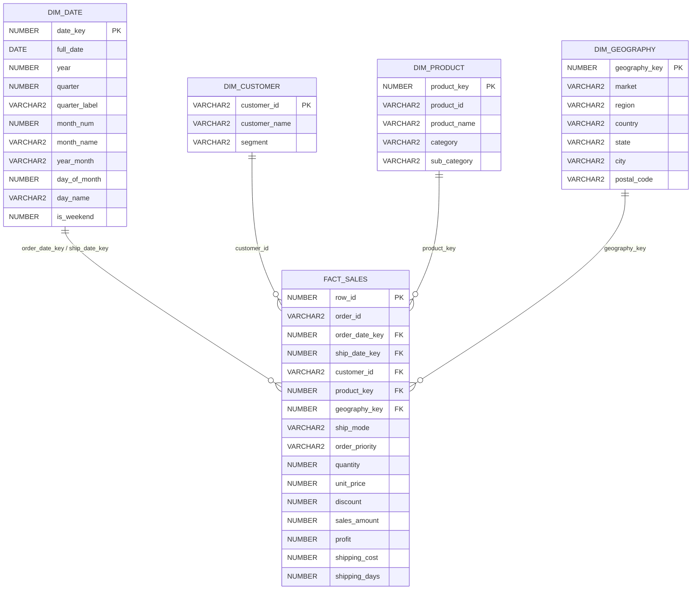

# Star Schema Architecture & ER Diagram (Project 1)

## 1. Conceptual Star Schema

The raw flat CSV (`51,290` rows x `24` columns) is normalized into **1 Fact Table** (`fact_sales`) and **4 Conformed Dimension Tables** (`dim_date`, `dim_customer`, `dim_product`, `dim_geography`) to eliminate data redundancy and prevent fan-out joins.

> **Design Note on `dim_product`:** In the source dataset, `10,292` distinct `Product ID` values map to `10,768` unique `(Product ID, Product Name, Category, Sub-Category)` combinations. Using a surrogate integer `product_key` prevents many-to-many join inflation.

---

## 2. Table Summary & Observed Row Counts

| Table | Role | Primary Key | Row Count | Notes |
|---|---|---|---|---|
| `fact_sales` | Fact (Grain: 1 order line) | `row_id` | `51,290` | Validated `quantity > 0` and `sales_amount > 0` |
| `dim_date` | Calendar Dimension | `date_key` (`YYYYMMDD`) | `1,468` | Covers all order dates & ship dates (`2011-01-01` to `2015-01-07`) |
| `dim_customer` | Customer Dimension | `customer_id` | `1,590` | 1:1 mapping with `customer_name` and `segment` |
| `dim_product` | Product Dimension | `product_key` (surrogate) | `10,768` | Preserves `Category -> Sub-Category -> Product Name` drill-down |
| `dim_geography` | Geography Dimension | `geography_key` (surrogate) | `3,847` | Preserves `Market -> Region -> Country -> State -> City` drill-down |
